<!-- Palette: black #0D1117 · green #39D353 · dark green #238636 · text #C9D1D9 -->

 

---

### `> about`

- **Tech Lead & Software Engineer** at [DC Solutions](https://www.dcs.ar/).
- I define project scope and stack architecture.
- I take on the hardest and most critical builds myself.
- Lately: MCP servers and agent tooling for reverse engineering and security research.

---

### `> stack`

  
  
  
  
  
  
  

**AI tooling**

  
  
  

---

### `> projects`

| Project | What it does | Built with |
| :--- | :--- | :--- |
| [**dotpeek-mcp**](https://github.com/matiasdante/dotpeek-mcp) | MCP server that decompiles .NET assemblies with dotPeek's own engine. Point an agent at a `.dll` and get the same C# dotPeek shows, no GUI. | C# · .NET |
| [**bug-bounty-anything**](https://github.com/matiasdante/bug-bounty-anything) | Agent skill + CLI/MCP engine for authorized vulnerability research, with scoped checks and verifiable evidence. On npm. | TypeScript · Node.js |

---

### `> activity`

